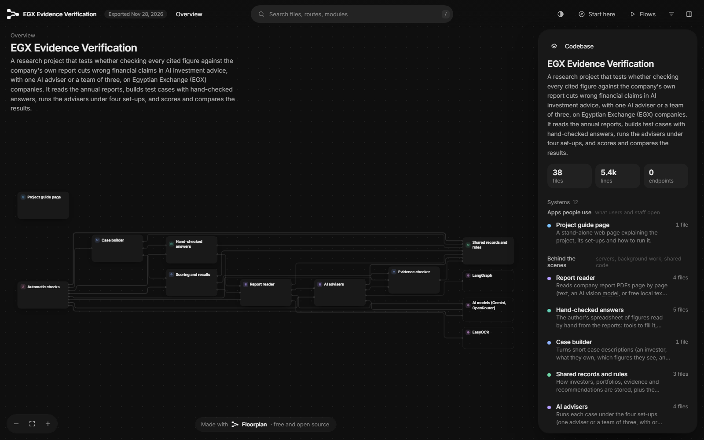

# EGX Evidence-Verified Investment Guide (research prototype)

**[Explore the interactive codebase map →](https://ziadmohamdd.github.io/EGX-Evidence-Verification/map/)** · [Architecture map section](#architecture-map)

[](https://ziadmohamdd.github.io/EGX-Evidence-Verification/map/)

Code for the paper on whether evidence verification reduces incorrect financial claims in single-agent and multi-agent investment recommendations. Scope and decisions are in [PROJECT_AUDIT_SUMMARY.md](PROJECT_AUDIT_SUMMARY.md). Terms are in [GLOSSARY.md](GLOSSARY.md).

## Conditions

| | Agents | Evidence verifier | Portfolio checks |
|---|---|---|---|
| A | single | off | on |
| B | single | on | on |
| C | multi (financial analyst, suitability analyst, decision agent) | off | on |
| D | multi | on | on |

## Layout

| File | What it does |
|---|---|
| `src/egx_guide/models.py` | Investor profile, portfolio, evidence items, recommendation schema, cases, conditions |
| `src/egx_guide/checks.py` | Mandatory portfolio checks: no unowned sales, no overselling, cash fits, share arithmetic |
| `src/egx_guide/verifier.py` | Evidence verifier: checks each cited figure, allows one revision, then drops and discloses |
| `src/egx_guide/agents.py` | Prompts for the single agent and the three team agents (development drafts) |
| `src/egx_guide/pipeline.py` | LangGraph workflow per condition |
| `src/egx_guide/runner.py` | Runs cases under conditions and saves one JSON record each |
| `src/egx_guide/llm.py` | Model access through TradingAgents' provider factory, with per-call logging |
| `src/egx_guide/numbers.py` | Reads printed amounts and units (Arabic-Indic digits, negatives, "بالألف جنيه", "EGP thousands") without a model |
| `src/egx_guide/documents.py` | Reads PDF pages: text layer, or a vision model or local OCR for scanned and Arabic pages |
| `src/egx_guide/ocr.py` | Free local OCR (EasyOCR) for Arabic scans, and the checks for numbers it may have misread |
| `src/egx_guide/extract.py` | Proposes figures with a model, then checks each one in code and marks it verified or ambiguous |
| `src/egx_guide/references.py` | Reference sheet for hand-checked figures, converts it to `figures.json`, measures the report reader's accuracy |
| `src/egx_guide/score.py` | Scores a run against the reference answers: wrong-claim rate before and after the verifier, coverage, acceptable action, portfolio violations |
| `vendor/TradingAgents` | Pinned at `9fa1196`, used only for model providers (Apache-2.0) |
| `docs/compatibility_check_tradingagents.md` | Why only part of TradingAgents is used |

## Setup

Python 3.12 virtual environment in `.venv`:

```powershell
.venv\Scripts\python -m pip install -e "vendor/TradingAgents" -e ".[dev]"
.venv\Scripts\python -m pytest -q
```

## Running

The project uses free models only. Put the free keys in the environment (`GOOGLE_API_KEY` for Gemini, `OPENROUTER_API_KEY` for OpenRouter's free models). Then:

```powershell
.venv\Scripts\python -m egx_guide.runner --cases data\cases\dev --conditions A B C D --provider google --model <model-name>
```

Results go to `runs/<timestamp>/<condition>/<case_id>.json` with a `manifest.json`.

`tests/fixtures/cases` holds **synthetic** cases for testing only. They are not real company figures.

## Reading a report into evidence

```powershell
.venv\Scripts\python -m egx_guide.extract --pdf reports\COMI_FY2024.pdf --company COMI --pages 3-6 --provider google --model <model-name>
```

The output is `data/evidence/<company>_<file>.json`. It holds the page text and how each page was read, every figure with its status and reasons, and the model calls. `--mode text` never uses the vision model, and `--mode vision` sends every page to it. In the default `auto` mode, scanned pages and Arabic text-layer pages go to the vision model, because Arabic text layers can come out reversed. So do table pages whose text layer has no unit line (CIB draws "EGP thousands" in the page header as graphics). `--mode ocr` reads those same pages with free local OCR (EasyOCR, Arabic and English; install with `pip install -e ".[ocr]"`) instead of a vision model. It is used for the Arabic scans, where free vision models invented pages. OCR figures with signs of a misread comma are marked ambiguous.

A figure is marked **verified** only if all of these hold: its number is found on the page, it reads without doubt, the unit is printed and consistent, the period is stated, and the page was not read from an Arabic text layer. Anything else is **ambiguous**, with the reason. These are automatic checks; the hand-checked reference figures remain the ground truth.

## Reference figures (hand-checked ground truth)

The author fills in [data/references/reference_sheet.xlsx](data/references/reference_sheet.xlsx) from the PDFs without looking at system output. An AI-assisted pass then checks every row against the page images and flags mismatches for the author to settle. Instructions: [docs/reference_answer_guide.md](docs/reference_answer_guide.md).

```powershell
.venv\Scripts\python -m egx_guide.references build --sheet data\references\reference_sheet.xlsx
.venv\Scripts\python -m egx_guide.references accuracy --figures data\references\figures.json --evidence data\evidence
```

`build` computes each value in base units with the same rules as the reader and lists problem rows. `accuracy` reports, per document, how many checked figures the reader got **correct**, got **wrong but marked verified** (the dangerous case), **flagged as ambiguous**, or **missed**.

## Building cases

A case spec in `data/cases/specs/` describes one case: investor profile, portfolio, information cutoff, the figures the agents get (by reference-sheet key, e.g. `COMI-en-net_profit_for_the_period-FY2025`), acceptable actions, and optionally one trap (`period`, `scale`, `unreadable`, `arabic_only`, `per_share`). Prices come from [data/cases/prices.json](data/cases/prices.json), which holds EGX closing prices with their source.

```powershell
.venv\Scripts\python -m egx_guide.cases                 # with hand-checked figures (data/references/figures.json)
.venv\Scripts\python -m egx_guide.cases --provisional   # development only: the reader's values stand in
```

Cases go to `data/cases/<dev|test>/` and their reference answers to `data/references/cases/`. Agents only see figures that have a reference. A figure the reader got wrong stays as read, and the reference holds the true value. If the reader's row label differs from the sheet, write the figure as `{"key": "...", "label": "Operating revenues"}`. Test cases refuse provisional references.

## Scoring a run

```powershell
.venv\Scripts\python -m egx_guide.score runs\<timestamp> --references data\references
```

A reference answer is one JSON file per case, built from the hand-checked reference figures by `egx_guide.cases`. Example: [tests/fixtures/references/synthetic_001.json](tests/fixtures/references/synthetic_001.json).

- `figures`: for every `evidence_id` in the case, the true `value` in base units (EGP, not millions). Set `"usable": false` (and `value` to null if unknown) for a figure that should not be relied on.
- `acceptable_actions`: the actions the authors accept for this case (`buy`, `hold`, `sell`, `keep_cash`, `insufficient_evidence`).

Each cited figure is judged against the reference, not against the evidence store the agents saw: **correct** (within 0.5%), **wrong_value** (with a note if it is off by a factor of 1,000 or more), **ambiguous_used**, or **unknown**. The scorer writes `scores.json` and `summary.csv` into the run folder and prints a table per condition. Accuracy and coverage (share of usable figures cited correctly) are always shown together. Run errors and cases without a reference are counted but not scored. These metric definitions are a draft until the primary endpoints are agreed.

## Evaluation plan

The hypotheses, main measure, sample size, statistics, case design, human rating and freeze rules are in [docs/evaluation_plan.md](docs/evaluation_plan.md).

## Not built yet

- Run the reader on real reports and measure how well it extracts against hand-checked figures
- The 30 test cases, and the filled-in, checked reference sheet
- Frozen prompts, the fee/lot-size assumptions, and the final model choice

## Architecture map

An interactive map of the codebase, made with [Floorplan](https://github.com/haydenschmitty/floorplan): every subsystem, module and file, with a one-line description and the imports between them.

**[Open the interactive codebase map →](https://ziadmohamdd.github.io/EGX-Evidence-Verification/map/)**
